TUJUAN

Membangun aplikasi daftar data dari REST API (JSONPlaceholder) yang memakai Dio terpusat, repository pattern, penanganan state asinkron dengan Riverpod AsyncValue, pagination infinite scroll, dan navigasi multi halaman dengan GoRouter.

FITUR UTAMA

- Konfigurasi Dio terpusat
- Model data dengan fromJson aman null
- Repository pattern: UI tidak memanggil Dio secara langsung
- AsyncValue: loading, error, empty, success
- Pesan error ramah pengguna
- Pagination infinite scroll 10 item per halaman

STACK TEKNOLOGI

- Flutter
- Dart
- dio
- flutter_riverpod
- go_router
- JSONPlaceholder (API dummy)

CARA MENJALANKAN

1. Buka terminal dan masuk ke direktori project (cd week4_api)
2. Unduh dan perbarui dependensi package (flutter pub get)
3. Jalankan aplikasi di emulator atau perangkat fisik (flutter run)
4. Verifikasi kualitas kode (flutter analyze)
5. Jalankan pengujian unit dan widget (flutter test)

MINI PROJECT

Bangun aplikasi daftar data dari REST API sebagai tugas minggu ini (kembangkan project codelab atau buat baru):

1. Ambil data dari API dummy (JSONPlaceholder /posts atau API publik lain tanpa key). Tampilkan ke UI melalui repository + Riverpod.

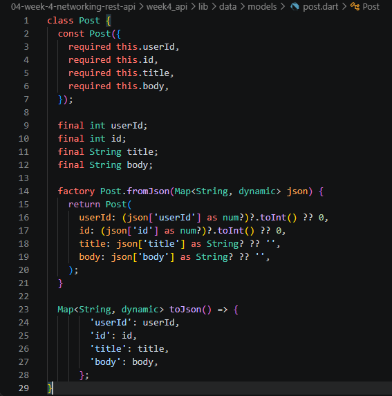

2. Terapkan Dio terpusat (base URL, timeout, interceptor logging) dan model fromJson aman null.

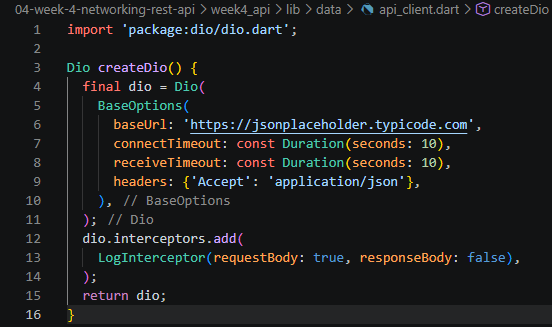

3. Tampilkan keempat state: loading, error (+ tombol retry), empty, success.

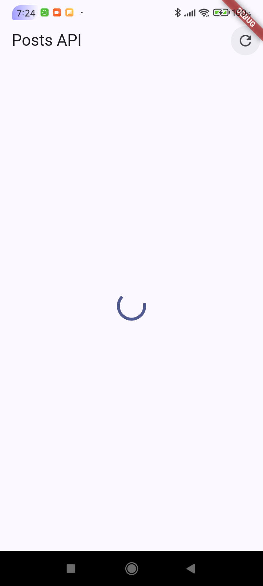

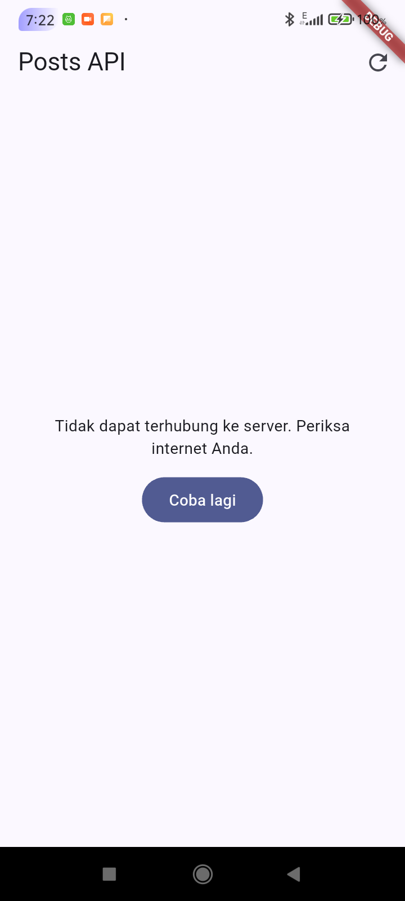

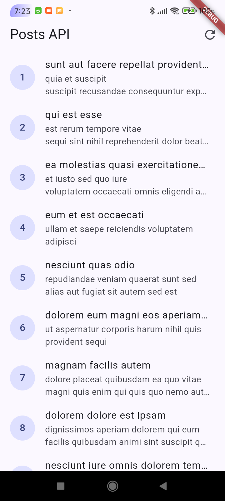

4. Tambahkan pagination dasar (infinite scroll, 10 item per halaman) dengan guard request ganda.

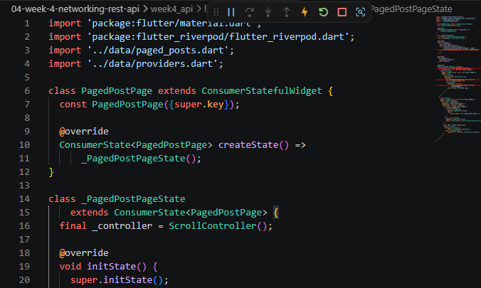

5. Sertakan minimal 2 test yang lulus (1 unit test model/error mapping + 1 test provider dengan repository palsu).

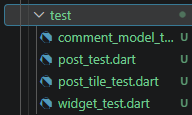

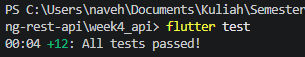

6. Kerjakan bagian AI Challenge dan dokumentasikan prompt, hasil AI, perbaikan, serta alasan keputusan teknis Anda di docs/.

AI PROMPT CHALLENGE

1. Prompt AI

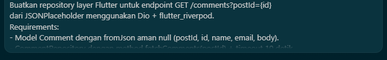

2. AI Verification Checklist:
- Apakah UI memanggil Dio secara langsung (dilarang) atau lewat repository? Lewat repository

- Apakah fromJson aman null, atau masih memakai cast langsung yang bisa crash? Aman null, Setiap field menggunakan pola (json['key'] as Type?) ?? defaultValue

- Apakah semua tipe DioExceptionType (timeout, connectionError, badResponse) dipetakan ke pesan pengguna? Ya, semua dipetakan. Dari friendlyCommentErrorMessage() di comment_providers.dart

- Apakah baseUrl/timeout terpusat di satu client, bukan tersebar di tiap method? Terpusat di lib/data/api_client.dart

- Apakah test AI benar-benar menguji kasus field hilang, atau hanya happy path? Tambahkan minimal 1 edge case sendiri. Menguji lebih dari happy path, ada edge case tambahan. Test di test/comment_model_test.dart

- Jalankan flutter analyze dan flutter test, apakah hasil AI lolos tanpa warning? 

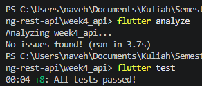

HASIL REFACTORING CHALLENGE

1. Ekstrak widget baris post menjadi PostTile tersendiri agar ListView.builder pendek dan mudah diuji.

2. Pindahkan friendlyErrorMessage ke file lib/data/network_errors.dart agar bisa dipakai ulang halaman paged dan non-paged.

3. Tambahkan halaman detail post dengan GoRouter (/post/:id) yang menampilkan title dan body lengkap, state detail diambil dari list yang sudah dimuat atau via repository bila langsung dibuka.

HASIL

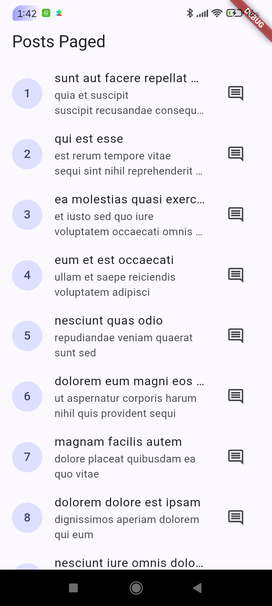

REFLEKSI

Mengapa UI dilarang memanggil Dio langsung? Apa yang rusak jika aturan ini dilanggar?

    UI dilarang memanggil Dio secara langsung karena melanggar prinsip Separation of Concerns dan menciptakan ketergantungan yang erat (tight coupling) antara tampilan dan protokol jaringan. Jika dilanggar, kode menjadi rapuh karena perubahan konfigurasi endpoint, header, maupun deserialisasi data akan memaksa perubahan di setiap file widget, duplikasi logika penanganan error tidak terhindarkan, serta proses unit testing dan widget testing menjadi sangat sulit karena panggilan jaringan tidak dapat dimock secara terisolasi.

Kapan pagination client-side cukup, dan kapan harus mengandalkan pagination server (_page/_limit)?

  Pagination client-side cukup bila seluruh data kecil (puluhan sampai beberapa ratus item), mudah diunduh sekaligus dalam satu respons, dan jarang berubah, sehingga paging hanya untuk kenyamanan tampilan. Pagination server (_page/_limit) wajib bila data besar atau terus bertambah, karena mengunduh semuanya membuang bandwidth, memori, dan baterai serta membuat waktu muat awal lama. Pagination server juga lebih tepat bila pencarian atau pengurutan harus dilakukan atas seluruh data. Pada JSONPlaceholder yang hanya berisi 100 post, client-side sebenarnya cukup, tetapi _page/_limit dipakai di sini untuk melatih pola yang akan dibutuhkan pada API sungguhan.

Bagaimana exception repository berubah menjadi AsyncError tanpa try/catch di setiap widget? Kapan try/catch eksplisit tetap dibutuhkan?

    Pada Riverpod, method build() di AsyncNotifier otomatis menangkap exception yang dilempar oleh repository dan langsung mengonversinya menjadi state AsyncError lengkap dengan stack tracenya, jadi UI cukup mendengarkan perubahan state tersebut menggunakan pola deklaratif seperti .when() tanpa perlu blok try/catch manual. Meskipun demikian, blok try/catch eksplisit tetap dibutuhkan pada aksi pengguna yang bersifat imperatif atau satu kali eksekusi (mutations seperti tombol Submit form atau Delete), di mana UI perlu menangani hasil secara lokal seperti menampilkan SnackBar, dialog konfirmasi, atau navigasi balik.

Bagian mana dari hasil AI yang Anda perbaiki, dan mengapa?

- AsyncNotifierProviderFamily dipakai sebagai konstruktor langsung, AI awalnya menulis AsyncNotifierProviderFamily<...>(...) padahal di Riverpod 3.x itu bukan public constructor. Yang benar yaitu AsyncNotifierProvider.family<NotifierT, StateT, ArgT>((arg) => Notifier(arg)) via builder pattern. Diperbaiki karena menyebabkan compile error.

- Duplikat import di paged_posts.dart. AI tidak mengecek file existing, sehingga ada 3 import duplikat yang menyebabkan analyzer warning. Jadinya dibersihkan.