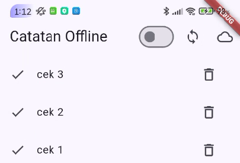
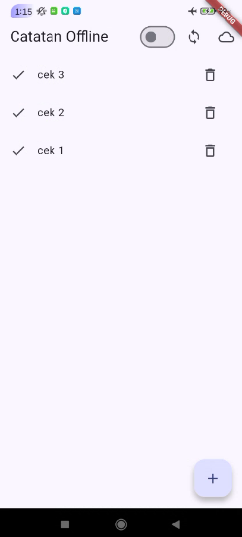
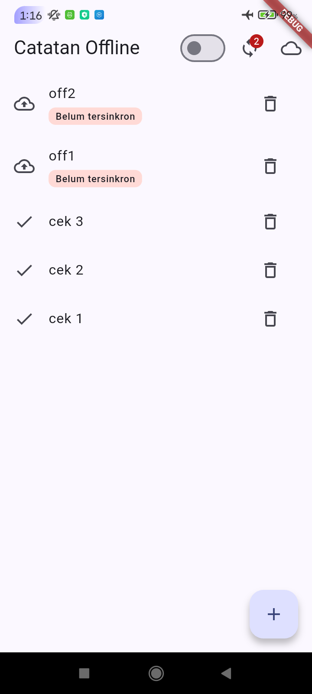
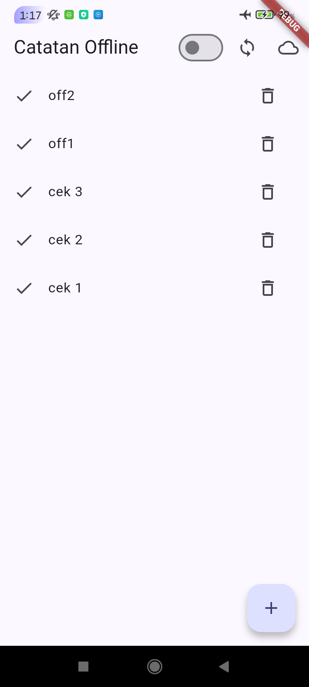
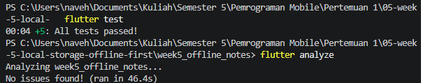
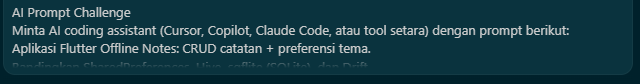
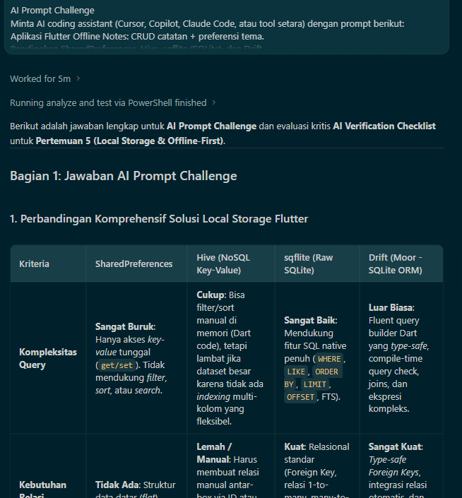
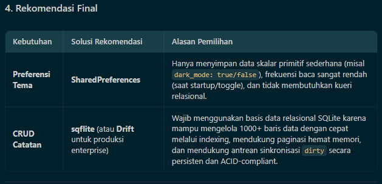
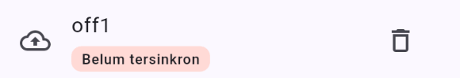

TUJUAN

Membangun aplikasi Offline Notes yang menyimpan data di perangkat dengan SharedPreferences dan SQLite (sqflite), menerapkan pola offline-first (cache-first read, dirty flag, dan sinkronisasi), serta menampilkan state loading, error, empty, dan success dengan Riverpod AsyncValue.

FITUR UTAMA

- Preferensi tema gelap/terang dan waktu terakhir dibuka dengan SharedPreferences
- CRUD catatan persisten dengan SQLite melalui repository lokal
- Dirty flag dan sinkronisasi catatan (simulasi) dengan badge jumlah catatan belum tersinkron
- Cache-first read untuk data posts dari JSONPlaceholder (tabel cached_posts)
- Toggle forceOffline untuk simulasi offline yang deterministik
- Halaman detail catatan dengan GoRouter (/note/:id)
- Berfungsi penuh dalam mode pesawat

STACK TEKNOLOGI

- Flutter
- Dart
- flutter_riverpod
- go_router
- shared_preferences
- sqflite
- path
- dio

CARA MENJALANKAN

1. Buka terminal masuk ke direktori project (cd week5_offline_notes)
2. Unduh dan perbarui dependensi package (flutter pub get)
3. Jalankan aplikasi di emulator atau HP
4. Verifikasi dengan flutter analyze
5. Jalankan flutter test

MINI PROJECT

Bangun aplikasi Offline Notes sebagai tugas minggu ini (kembangkan project codelab atau buat baru):

1. Preferensi: toggle tema gelap/terang + waktu terakhir dibuka via SharedPreferences.

2. CRUD catatan persisten via SQLite (sqflite) melalui repository lokal + Riverpod; daftar diurutkan updated_at terbaru.

3. Offline-first: cache-first untuk data bacaan, dirty flag + syncNotes untuk tulisan, dan aturan konflik eksplisit yang didokumentasikan.

4. Buktikan mode pesawat: screenshot daftar catatan saat offline dan badge dirty sebelum/sesudah sync.

5. Sertakan minimal 2 test yang lulus (1 unit test model + 1 test provider dengan repository palsu).

6. Kerjakan bagian AI Challenge dan dokumentasikan prompt, tabel perbandingan storage, keputusan final, serta alasan teknis Anda di docs/.

AI PROMPT CHALLENGE

1. Prompt AI

2. Tabel perbandingan storage

Keputusan final: SharedPreferences untuk preferensi, sqflite untuk catatan.

3. AI Verification Checklist:
- Apakah AI menempatkan daftar catatan di SharedPreferences? Tidak, daftar catatan ditempatkan di database (SQLite)
- Apakah skema AI mendukung antrean sync (dirty flag / updated_at) atau hanya CRUD polos? Ya, tabel notes memiliki kolom dirty dan updated_at
- Apakah klaim "real-time" AI didukung stream (Drift/watch) atau hanya asumsi? Stream hanya tersedia di Drift dan Hive, sedangkan sqflite tidak punya stream bawaan sehingga refresh dilakukan manual dengan ref.invalidate
- Apakah estimasi boilerplate AI masuk akal setelah dicoba instalasinya? Masuk akal, Drift dan Hive membutuhkan code generation (build_runner), sedangkan sqflite cukup SQL dan mapping manual
- Keputusan final dan alasan: SharedPreferences + sqflite. 

HASIL REFACTORING CHALLENG

1. Ekstrak baris catatan menjadi widget NoteTile tersendiri yang menampilkan badge "belum tersinkron" bila dirty == true.

2. Pindahkan logika cache posts dan syncNotes ke file lib/data/sync.dart agar repository tetap fokus pada CRUD.

3. Tambahkan halaman detail catatan dengan GoRouter (/note/:id) yang membaca dari repository lokal, bukan dari state halaman list.

REFLEKSI

Mengapa daftar catatan tidak boleh disimpan di SharedPreferences? Apa yang rusak jika aturan ini dilanggar?

  SharedPreferences cocoknya untuk nilai seperti flag atau satu setting. Kalau daftar catatan dimasukkan ke sana, seluruh list harus dijadikan satu string JSON, jadi mengubah satu catatan berarti mendecode semuanya lalu menulis ulang semuanya. Query, filter, dan pengurutan tidak tersedia, update parsial jadi mahal dan gampang menimpa data lain, dan dirty flag per catatan mustahil dibuat. Sinkronisasi ikut rapuh, lalu makin lambat begitu catatan menumpuk. Data berbentuk koleksi memang seharusnya tinggal di database yang punya query dan transaksi.

Kapan cache-first cukup, dan kapan Anda membutuhkan strategi lain (misalnya network-first untuk data harga real-time)?

  Cache first sudah cukup untuk data yang jarang berubah dan tidak berbahaya kalau sedikit outdated, misalnya daftar posts atau catatan pribadi: pengguna langsung melihat isi layar, lalu datanya diperbarui diam-diam di background. Harga real-time, saldo, atau stok lain ceritanya, karena angka yang outdated bisa menyesatkan orang. Di situ yang dipakai network first, yaitu ambil dari jaringan dulu dan jadikan cache cadangan ketika jaringan gagal.

Bagaimana dirty flag berubah menjadi antrean sync tanpa memblokir UI? Kapan antrean terpisah (tabel outbox) menjadi perlu?

  Setiap perubahan lokal langsung ditulis ke SQLite dengan dirty = 1, jadi UI menampilkannya saat itu juga tanpa menunggu jaringan. Sinkronisasi berjalan asinkron lewat await sehingga UI tetap responsif baru setelah server membalas sukses, markAllSynced mengembalikan dirty ke 0, sedangkan badge dihitung dari countDirty. Tabel outbox mulai dibutuhkan saat dirty flag tidak lagi cukup. Operasi hapus contohnya, karena barisnya sudah hilang dan tidak ada tempat untuk menaruh flag, atau saat urutan create, update, dan delete harus dijaga. Kebutuhan mencatat jumlah percobaan ulang dan menangani konflik yang lebih ruwet menambah alasannya.

Bagian mana dari rekomendasi AI yang Anda tolak, dan mengapa?

  Ai langsung merekomendasikan SharedPreferences dan sqlite atau drift, saya menolak drift dan memakai sqlite saja.
 