TUJUAN

Membangun Campus Notification App yang mengimplementasikan autentikasi dengan guard route GoRouter, penyimpanan token aman dengan flutter_secure_storage, Dio dengan refresh token otomatis, serta Firebase Cloud Messaging (FCM) lengkap dengan permission, token lifecycle, topic messaging, dan deep link notifikasi pada tiga app state (foreground, background, terminated).

FITUR UTAMA

- Login mock dengan guard route: pengguna yang belum login selalu diarahkan ke /login
- Token access dan refresh disimpan di flutter_secure_storage (bukan SharedPreferences)
- Dio interceptor: refresh otomatis satu kali saat 401, sesi dibersihkan bila refresh gagal
- FCM: permission, getToken, onTokenRefresh, dan subscribe topik pengumuman-kampus
- Notifikasi gabungan notification + data dengan deep link ke /pengumuman/:id
- Tiga app state ditangani: onMessage (foreground), onMessageOpenedApp (background), getInitialMessage (terminated)
- Background handler top-level dengan @pragma('vm:entry-point')

STACK TEKNOLOGI

- Flutter
- Dart
- flutter_riverpod
- go_router
- dio
- flutter_secure_storage
- firebase_core
- firebase_messaging
- flutter_local_notifications

CARA MENJALANKAN

1. Buka terminal dan masuk ke direktori project (cd campus_notify)
2. Letakkan google-services.json dari project Firebase Anda di android/app/
3. Unduh dan perbarui dependensi package (flutter pub get)
4. Jalankan aplikasi di perangkat fisik atau emulator dengan Google Play Services (flutter run)
5. Verifikasi kualitas kode (flutter analyze)
6. Jalankan pengujian unit (flutter test)

Login mock: email harus mengandung "@" dan kata sandi minimal 6 karakter.

MINI PROJECT

Bangun Campus Notification App (kembangkan project codelab atau buat baru):

1. Login (mock/Firebase Auth) dengan guard route: belum login selalu diarahkan ke /login.

Login memakai AuthRepository mock yang siap diganti dengan Firebase Auth pada satu titik (method login). Guard dibuat dengan redirect GoRouter yang membaca authStateProvider.

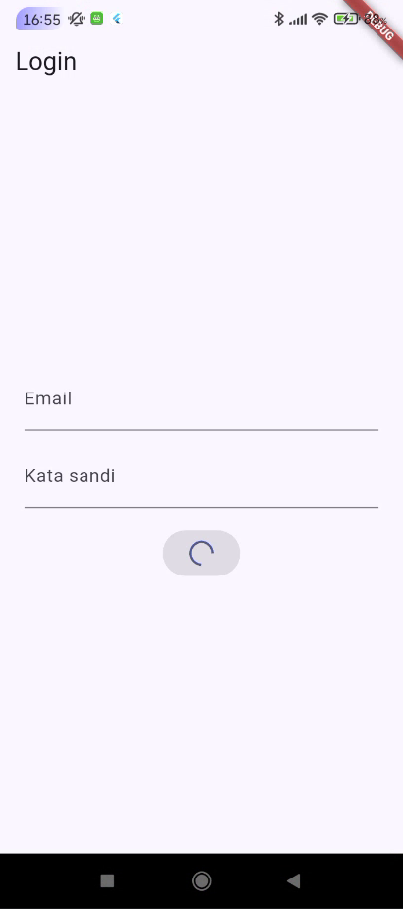

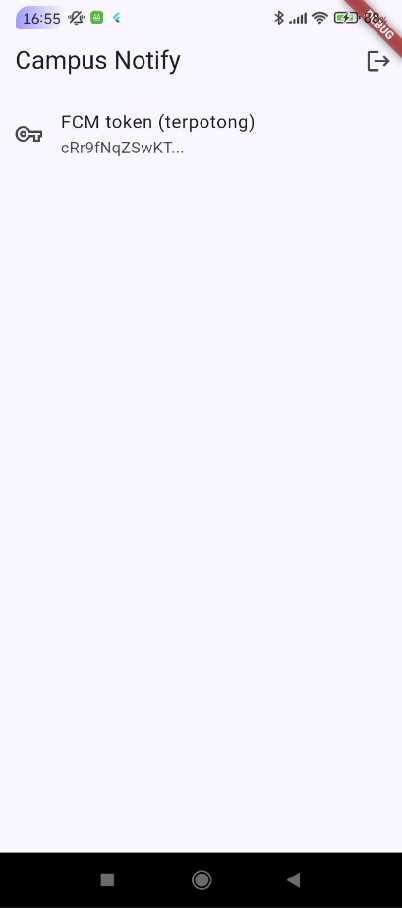

2. Token disimpan di secure storage; Dio otomatis refresh sekali saat 401 dan logout bila refresh mati.

Seluruh akses token melalui kelas TokenStore (flutter_secure_storage). Interceptor di api_client.dart mencoba refresh satu kali saat menerima 401, lalu mengulang request. Bila refresh gagal, token dibersihkan (clear) dan pengguna diarahkan kembali ke /login. Backend belum tersedia, sehingga refresh dibuktikan lewat logika sesi pada unit test.

3. FCM terintegrasi: permission, getToken + onTokenRefresh terkirim ke backend (atau didokumentasikan endpoint POST /devices), dan subscribe topik pengumuman-kampus.

Backend belum tersedia, sehingga pengiriman token didokumentasikan sebagai endpoint:

POST /devices
Body: {"fcm_token": "<token>", "platform": "android"}

Token ditampilkan terpotong (12 karakter pertama) di halaman Home. Setelah data aplikasi dihapus, token baru terbentuk dan callback onToken menerimanya.

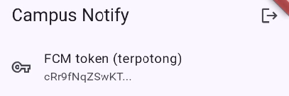

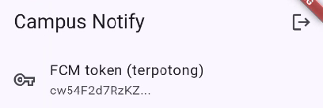

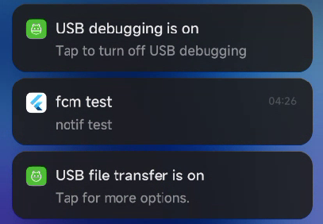

4. Notifikasi gabungan notification + data; klik membuka /pengumuman/:id pada ketiga app state. Isi tabel pengujian foreground/background/terminated di README.

Payload yang diuji (Firebase Console, Custom data):

title: Jadwal kuliah berubah
body: Kelas Mobile pindah ke Ruang A2 jam 13.00
data.route: /pengumuman/3
data.id: 3

| State | Yang diharapkan | Cara uji | Hasil |
|---|---|---|---|
| Foreground | Banner lokal muncul, klik masuk ke /pengumuman/3 | Aplikasi terbuka, kirim dari console | Muncul |
| Background | Banner sistem muncul, klik masuk ke /pengumuman/3 | Tekan Home, kirim, klik banner | Muncul |
| Terminated | Aplikasi terbuka ke /pengumuman/3 via getInitialMessage | Swipe-close aplikasi, kirim, klik banner | Muncul |

Foreground

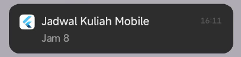

Background

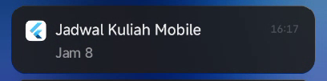

Terminated

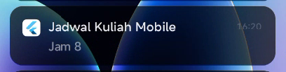


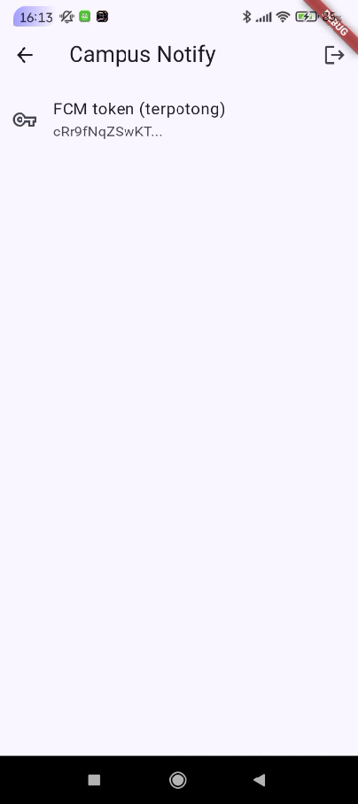

5. Screenshot bukti (token terpotong, banner tiap state, halaman tujuan deep link) di folder screenshots/.

Ada di folder screenshots

6. Sertakan minimal 2 test yang lulus (parsing route + logika sesi/refresh).

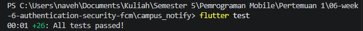

7. Kerjakan AI Challenge dan dokumentasikan prompt, output awal AI, perbaikan manual, dan alasan teknis di docs/.

AI PROMPT CHALLENGE

1. Prompt AI

```text
Aplikasi Flutter Campus Notification App.
Stack: firebase_messaging, flutter_local_notifications,
flutter_secure_storage, go_router, Riverpod.
Buatkan PushService dengan:
- requestPermission + getToken + onTokenRefresh (kirim ke POST /devices)
- onMessage (tampilkan local notification manual)
- onMessageOpenedApp + getInitialMessage (navigasi ke data.route)
- subscribe/unsubscribe topic pengumuman-kampus
- background handler top-level dengan @pragma('vm:entry-point')
Tandai bagian yang BERBEDA untuk Android 13+ vs iOS,
dan bagian yang tidak boleh mengakses BuildContext.
```

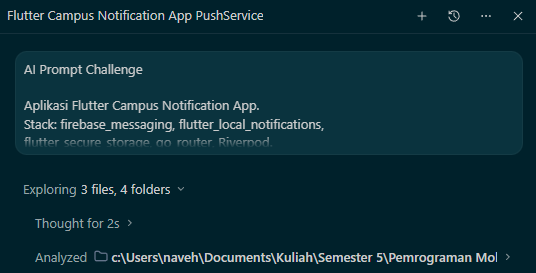

2. AI Verification Checklist:
- Apakah background handler berupa fungsi top-level dengan @pragma('vm:entry-point')? Ya, firebaseMessagingBackgroundHandler di lib/messaging/push_service.dart adalah fungsi top-level, tidak mengakses BuildContext maupun Riverpod, dan hanya menyimpan pending_route ke secure storage
- Apakah onTokenRefresh benar-benar mengirim token baru ke backend, bukan hanya dicetak ke log? Ya, token dari getToken dan onTokenRefresh sama-sama diteruskan ke callback yang memanggil POST /devices (body fcm_token dan platform, header Authorization). Token yang sama tidak dikirim ulang (de-duplikasi lewat secure storage). Backend memakai URL fiktif sehingga request gagal pada pengujian, dan kegagalan tersebut tidak menghentikan setup push
- Apakah foreground memakai local notification manual? Ya, listener onMessage menampilkan banner lewat flutter_local_notifications karena FCM tidak menampilkan banner otomatis saat aplikasi terbuka
- Apakah klik dari ketiga state masuk ke rute yang benar? Foreground lewat onDidReceiveNotificationResponse, background lewat onMessageOpenedApp, terminated lewat getInitialMessage yang dipanggil setelah authStateProvider selesai dibaca agar tidak dialihkan guard ke /login. Hasil uji nyata ada pada tabel Mini Project nomor 4
- Apakah token/secret tidak di-hardcode dan tidak di-log penuh? Ya, log selalu memakai shortToken() (12 karakter pertama), URL backend tidak berisi secret, dan token login hanya di flutter_secure_storage
- Keputusan final dan alasan teknis:
  - De-duplikasi token POST dengan secure storage, agar backend tidak dibanjiri request saat aplikasi sering dibuka ulang
  - Navigasi lewat GoRouter global, bukan Navigator.of(context), karena context tidak tersedia pada semua app state
  - Background handler hanya menyimpan pending_route, karena isolate terpisah tidak boleh mengakses widget tree atau Riverpod
  - Token FCM tidak pernah dicetak penuh, agar tidak bocor lewat log sistem


3. Bagian hasil AI yang diperbaiki:
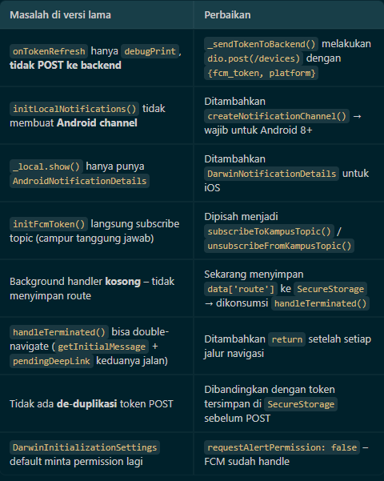


HASIL REFACTORING CHALLENGE

1. Pindahkan semua string rute (/login, /pengumuman/:id) ke satu file lib/routes.dart agar deep link dari FCM dan GoRouter memakai konstanta yang sama.

2. Ekstrak parsing RemoteMessage -> route ke fungsi murni routeFromMessage(Map<String, dynamic> data) agar bisa diunit-test tanpa Firebase.

3. Pindahkan pemetaan DioException -> pesan ramah pengguna (401, timeout, offline) ke lib/data/api_errors.dart agar UI hanya menerima pesan, bukan exception mentah.

HASIL

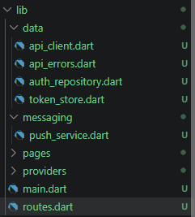

HASIL TEST


REFLEKSI

Mengapa refresh token tidak boleh disimpan di SharedPreferences? Apa risikonya bila bocor?

  SharedPreferences menyimpan data sebagai teks biasa tanpa enkripsi di penyimpanan aplikasi, sehingga bisa terbaca lewat backup perangkat, perangkat yang di-root, atau malware. Refresh token berumur panjang dan dipakai untuk meminta access token baru, jadi bila bocor penyerang bisa terus menerbitkan access token baru dan menyamar sebagai pengguna tanpa mengetahui kata sandi, bahkan setelah access token lamanya kedaluwarsa. flutter_secure_storage memakai Keystore (Android) dan Keychain (iOS) sehingga data tersimpan terenkripsi. Risiko tetap dikurangi dengan umur token yang terbatas dan kemampuan server mencabut refresh token.

Apa yang rusak bila onTokenRefresh diabaikan selama satu semester perkuliahan?

  Token FCM bisa berubah karena instal ulang, hapus data aplikasi, pemulihan ke perangkat baru, atau rotasi keamanan. Bila perubahan itu tidak diteruskan, backend terus menyimpan token basi sehingga pesan personal seperti nilai atau tagihan dikirim ke token yang sudah tidak valid dan gagal tanpa terlihat oleh pengguna. Seiring waktu semakin banyak mahasiswa yang berhenti menerima notifikasi tanpa ada error di aplikasi, dan backend dipenuhi token mati yang membuang kuota pengiriman.

Kapan memakai topik dan kapan memakai token perangkat? Beri contoh pesan kampus untuk masing-masing.

  Topik dipakai untuk broadcast ke banyak penerima yang sama jenisnya, misalnya "Jadwal kuliah berubah untuk semua mahasiswa satu kelas", "Libur kampus", atau pengumuman satu UKM. Token perangkat dipakai untuk pesan personal, misalnya "Nilai UTS Anda sudah keluar" atau "Tagihan UKT Anda jatuh tempo". Pesan personal tidak boleh lewat topik karena siapa pun yang berlangganan topik menerima isinya, sedangkan token hanya menuju satu perangkat milik pengguna tertentu.

Bagian mana dari draf AI yang Anda tolak atau perbaiki, dan mengapa?

  Output AI menandai semua item verifikasinya dengan centang, tetapi saya memverifikasinya sendiri karena AI tidak bisa membuktikan perilaku di perangkat nyata. Saya memperbaiki pemakaian flutter_local_notifications yang masih berparameter posisi padahal versi paket sudah memakai parameter bernama, menambahkan navigasi pada klik banner foreground yang semula hanya menyimpan payload, dan memastikan deep link menunggu status login selesai dibaca agar tidak dialihkan guard ke halaman login. Perbaikan ini penting karena kode terlihat benar saat dibaca, tetapi perilaku nyatanya baru terbukti setelah diuji pada ketiga app state.